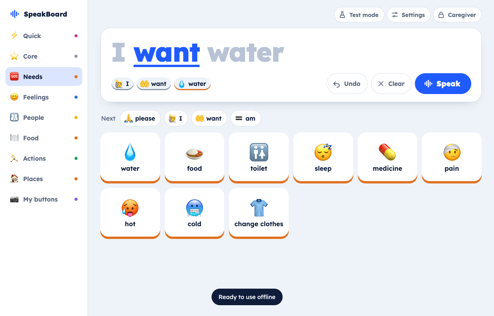
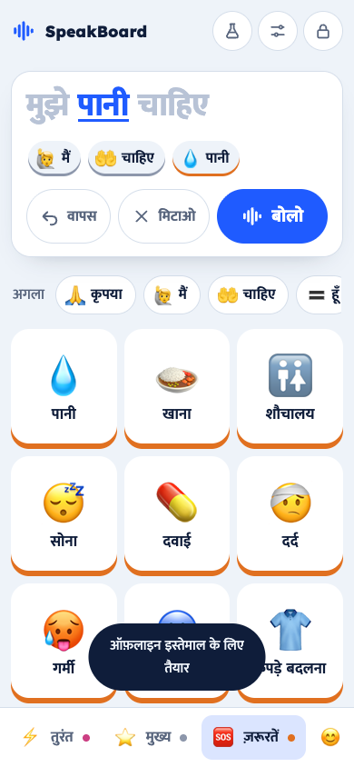
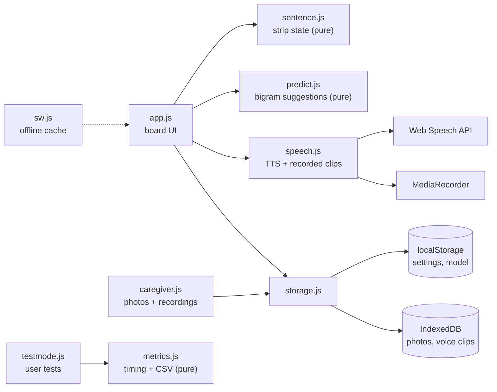

# SpeakBoard

**A free, offline picture communication board for people who cannot speak, in their own language.**

Tap pictures to build a sentence ("I" → "want" → "water"), and the phone says it out loud. It works in
airplane mode, runs in any modern browser, and a caregiver can add photos of the person's own family,
food and places, and even record the buttons in a family member's voice.

**Try it: [satyams018.github.io/speakboard](https://satyams018.github.io/speakboard/)**. Open it once
and it keeps working offline; on a phone, use "Add to Home screen" to install it like an app.

**Watch the demo video: [youtu.be/OMDTXnP7K4M](https://youtu.be/OMDTXnP7K4M)**





## Why

People who cannot speak because of autism, cerebral palsy, stroke, ALS or other conditions use
_augmentative and alternative communication_ (AAC) to say what they need. Dedicated AAC devices and
apps are expensive, often English-first, and assume a good phone and internet connection.

- About **2.5 billion people** need one or more assistive products, and nearly **1 billion are denied
  access**. Access can be as low as 3% in some low- and middle-income countries
  ([WHO, 2022](https://www.who.int/news/item/16-05-2022-almost-one-billion-children-and-adults-with-disabilities-and-older-persons-in-need-of-assistive-technology)).
- The gaps are largest for **communication** and cognition, and about two thirds of users pay out of
  pocket (same WHO report).

SpeakBoard aims to be the board a family can start using in five minutes, on the cheap phone they
already have, for free.

## What it does

| Feature                  | Details                                                                                                                                               |
| ------------------------ | ----------------------------------------------------------------------------------------------------------------------------------------------------- |
| Picture board            | 59 words in 7 colour-coded categories (simplified Fitzgerald key), plus 12 one-tap quick phrases such as "I need help".                               |
| Speaks out loud          | Uses the device's built-in text-to-speech, entirely on the device.                                                                                    |
| 3 languages              | English, Hindi and Spanish for every button and the interface. Switch any time in Settings.                                                           |
| Next-picture suggestions | A small on-device model learns which word this person usually says next, so common sentences take fewer taps.                                         |
| Caregiver photos         | Add, edit and delete buttons with a photo of a real person, food or place, in any category. Photos are shrunk to a few KB and never leave the device. |
| Family voice             | Record any button (built-in or custom) in a family member's voice. Also fixes languages the device has no voice for.                                  |
| Recent sentences         | The last 10 sentences, ready to say again with one tap.                                                                                               |
| Help button              | One tap: full-screen "I need help", a siren and the phrase spoken aloud until someone presses Stop.                                                   |
| Works offline            | A service worker caches the app; it can be installed to the home screen and used in airplane mode.                                                    |
| Built-in user test       | Test mode times 5 everyday messages on SpeakBoard vs typing them, and exports the results as CSV.                                                     |
| Accessible               | Large targets, three button sizes, keyboard support, visible focus, dark mode, reduced-motion support.                                                |

The caregiver tools are behind a **one-second press** so the user can't open them by accident.

## Measured result

Test mode gives a repeatable number: for 5 everyday messages, median seconds and taps on SpeakBoard
versus typing the same message on the phone keyboard.

**5 testers (T1–T5), 5 messages each, 50 trials in English:**

|                           | SpeakBoard | Typing | Difference  |
| ------------------------- | ---------- | ------ | ----------- |
| Median time per message   | 4.8 s      | 6.0 s  | 1.3× faster |
| Median taps / key presses | 4          | 14     | 3.5× fewer  |
| Messages completed        | 100%       | 100%   | same        |

- SpeakBoard was faster for 4 of the 5 messages. The exception was "I am tired" (5.0 s vs 4.4 s),
  a short message that is quick to type.
- Every tester was at least as fast on SpeakBoard as typing (per tester: 1.0× to 1.8× faster).
- For someone who can't speak, the drop in taps matters most: every tap is effort for people with
  limited hand control, and SpeakBoard needs about a quarter as many.

The testers were not AAC users, so this measures how efficient the interface is, not clinical
benefit. The raw data is in [`docs/user-test-results.csv`](docs/user-test-results.csv).

To run a session: open **Test mode**, enter a tester label, press Start, and follow the prompts. The
board tasks appear above the sentence strip; the typing tasks appear in a dialog afterwards. Results
for all testers are saved on the device and can be downloaded together as CSV.

## Architecture

There is no server and no build step: static files plus browser APIs.



- **Pure modules** (`sentence.js`, `predict.js`, `metrics.js`, `vocab.js`, `i18n.js`) hold the logic and
  are unit-tested without a browser.
- **`storage.js`** wraps localStorage and IndexedDB; every access is guarded so the app still works
  when storage is blocked (for example in a private window).
- **`speech.js`** plans each sentence into segments: recorded clips where they exist, text-to-speech
  for the rest.

Design choices and their trade-offs are recorded in [`docs/decisions.md`](docs/decisions.md).

## Run it locally

Requirements: Node.js 20 or newer.

```bash
npm install
npm run dev      # serves src/ at http://localhost:5180
```

Open the URL in Chrome, Edge or Safari. To try it offline, load it once, then turn off the network and
reload.

## Tests and linting

```bash
npm test         # Vitest unit tests (sentence, grammar, suggestions, speech, metrics, storage)
npm run lint     # ESLint + Prettier check
npm run test:e2e # presses every control in real Chrome (needs Google Chrome; set CHROME_PATH)
```

GitHub Actions runs the unit tests and lint on every push and pull request. The browser check
follows the behaviour spec in [`docs/buttons.md`](docs/buttons.md).

## Deploy

The `src/` folder is a complete static site. Any static host works (GitHub Pages, Netlify, Cloudflare
Pages). It must be served over HTTPS for the service worker and microphone to work.

If you change any file in `src/`, bump `VERSION` in `src/sw.js` so installed copies update.

The PNG app icons are generated by `node scripts/make-icons.mjs` (no image library needed).

## Tech stack

Vanilla JavaScript (ES modules), HTML, CSS · Web Speech API · MediaRecorder · IndexedDB · Service
Worker + Web App Manifest · Vitest, fake-indexeddb · ESLint, Prettier · GitHub Actions.

## Limitations and next steps

- **Grammar covers common patterns only.** `grammar.js` fixes word order for want / need / like / am
  ("मुझे पानी चाहिए", "I want to go home", "tengo frío"); other sentences are spoken in tap order.
  A "Word forms" setting picks male or female forms for Hindi and Spanish.
- **Device voices vary.** Some phones have no Hindi or Spanish voice. The app warns about this, and a
  caregiver can record the buttons the person uses most.
- **Translations need review.** Hindi and Spanish text should be checked by native speakers.
- **Symbols are emoji**, which look slightly different on each platform. Next: an open AAC symbol set
  such as Mulberry Symbols.
- Next: switch scanning for people who cannot tap precisely, more languages, and backup/restore of
  caregiver buttons.

SpeakBoard is a communication aid, not a medical device, and does not replace speech-language therapy.

## License

MIT
